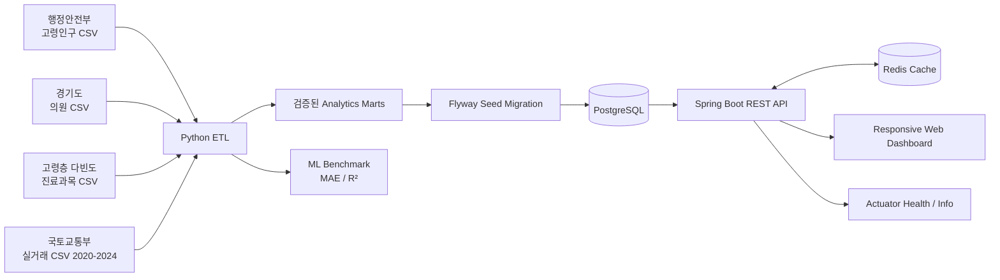

# Architecture

## Boundary decisions

- The two source analyses remain separate bounded contexts. Gyeonggi health supply and Seoul
  housing prices have different populations and geography, so a single “livability score” would
  imply a relationship the data cannot support.
- Python owns ingestion, cleaning, feature engineering, scoring and model evaluation.
- Clinic regions are normalized from a valid Gyeonggi address before the unreliable source region
  label is used as a fallback. Median clinic coordinates support the dashboard's relative location
  plot without requiring a map API key.
- The disease-specialty workbook lacks a stated period and geographic scope. The service therefore
  exposes it only beside local specialty supply and does not use it in the priority score.
- Java owns validated query APIs, caching, persistence and the browser-facing application.
- Generated CSV marts and a Flyway migration form a reviewable data contract between the layers.
  The export step validates the marts first (no empty required values, unique region/specialty
  keys, every active clinic mapped to a known region) so a bad refresh fails at build time instead
  of producing a migration that breaks at deploy time.
- V2/V3 are generated but already applied in existing databases. Regenerating them changes their
  Flyway checksum; data refreshes for a long-lived database must ship as a new versioned migration.
- Local profile uses H2 and the Docker profile uses PostgreSQL + Redis. This keeps onboarding fast
  while exercising production-oriented infrastructure.

## Reliability and security choices

- No API credentials are committed. Historical notebook keys and machine-specific paths were removed.
- Dependency versions are constrained, raw-to-mart transformations are deterministic, and CI checks
  that generated artifacts do not drift.
- API list limits and region path lengths are validated, entities are not exposed directly, database
  schema is validated at startup, and the container runs as a non-root user.
- Every API error is an RFC 9457 Problem Details response. Unexpected exceptions are logged
  server-side and returned as a generic 500 without internal messages.
- Rankings use a deterministic order (score, then region) so equal scores never reorder between
  requests or databases. List queries fetch only the requested page instead of the whole table.
- Redis entries expire after 10 minutes. Redis is an accelerator, not a dependency: cache read/write
  errors are logged and the request falls through to PostgreSQL (1 s Redis timeouts keep this fast).
  The container health check uses the readiness probe for the same reason.
- Actuator publicly exposes only `health` and `info`. Metrics are opt-in per environment through
  `MANAGEMENT_ENDPOINTS_WEB_EXPOSURE_INCLUDE` because there is no authentication in front of them.
- PostgreSQL and Redis ports are published on `127.0.0.1` only in Docker Compose.
- Responses are gzip-compressed and static assets are served with `Cache-Control: no-cache`
  (Last-Modified revalidation), so a redeploy is visible immediately while unchanged files cost a 304.

## Dashboard behaviour

- Requests time out after 10 seconds; failures replace loading placeholders with an error message
  and a single retry action that ignores repeated clicks while a request is in flight.
- Empty data, empty filter results and a failed specialty request each have their own message; a
  specialty failure does not affect the rest of the page.
- Rankings, table rows and map points are keyboard operable, the selected region is exposed with
  `aria-pressed`/`aria-current`, and smooth scrolling respects `prefers-reduced-motion`.
